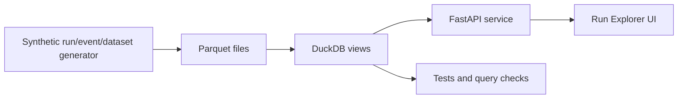

# Research Run Platform

Research-run data platform sample project for roles that build tooling for frontier-model research workflows.

This is intentionally shaped around a Research Data Platform brief: ingest run data, land it in queryable storage, expose APIs researchers can use, track dataset provenance, and provide a compact web explorer for run analysis.

## Why This Exists

Research teams need fast, trustworthy ways to answer questions like:

- Which training or eval runs used this dataset version?
- Did a candidate run improve metrics or only move cost/latency?
- Why did a run fail, and which dataset transform caused it?
- Can a researcher inspect run events, metrics, lineage, and notes without asking a platform engineer?

This repo demonstrates the platform layer around that workflow: DuckDB + Parquet storage, deterministic seed data, FastAPI endpoints, lineage views, comparison APIs, and a browser-based run explorer.

## What It Proves

| Skill | Implementation |
|---|---|
| Queryable research-run data | Run, dataset, event, and lineage tables exported to Parquet and queried through DuckDB views |
| Data products for technical users | FastAPI endpoints and a compact run explorer for filtering, inspection, and provenance |
| Dataset lineage/provenance | Dataset versions include parents, transforms, content hashes, and lineage edges |
| Metrics and experiment comparison | Summary and comparison APIs expose accuracy, helpfulness, harmlessness, cost, and duration deltas |
| Production-minded reliability | Tests cover storage, filters, run detail, lineage, API health, and comparison behavior |

## Architecture



## Quickstart

```bash
uv sync --extra dev
uv run rdp-seed --force
uv run pytest
uv run uvicorn rdp.api:app --reload --port 8010
```

Then open:

```text
http://127.0.0.1:8010
```

## API

```bash
curl http://127.0.0.1:8010/api/health
curl "http://127.0.0.1:8010/api/runs?status=succeeded&min_accuracy=0.90"
curl http://127.0.0.1:8010/api/runs/run_2026_05_30_002
curl http://127.0.0.1:8010/api/runs/run_2026_05_30_002/lineage
curl "http://127.0.0.1:8010/api/compare?base_run_id=run_2026_05_30_001&candidate_run_id=run_2026_05_30_002"
curl http://127.0.0.1:8010/api/metrics/summary
```

## Data Model

- `runs`: model, task, dataset version, status, run timing, token count, eval metrics, cost, owner, notes.
- `datasets`: dataset version, source, row count, creation time, content hash, parent dataset, transform, risk level.
- `events`: run-stage events and attached metrics.
- `lineage`: edges connecting datasets, transforms, and runs.

## Role Mapping

This maps directly to research-data-platform work:

- Build and operate pipelines that extract data from experiment runs into queryable storage.
- Design APIs and web interfaces for data exploration and analysis.
- Develop dataset management, cataloging, and provenance tooling.
- Embed with technical users by making the UI/API answer the questions researchers ask every day.
- Build on existing data infrastructure primitives rather than reinventing storage from scratch.

## Scope Choices

This is a proof repo, so the data is synthetic and deterministic. The important part is the shape of the system: Parquet/DuckDB storage, typed API contracts, provenance-aware queries, and a run explorer that makes platform data inspectable.
